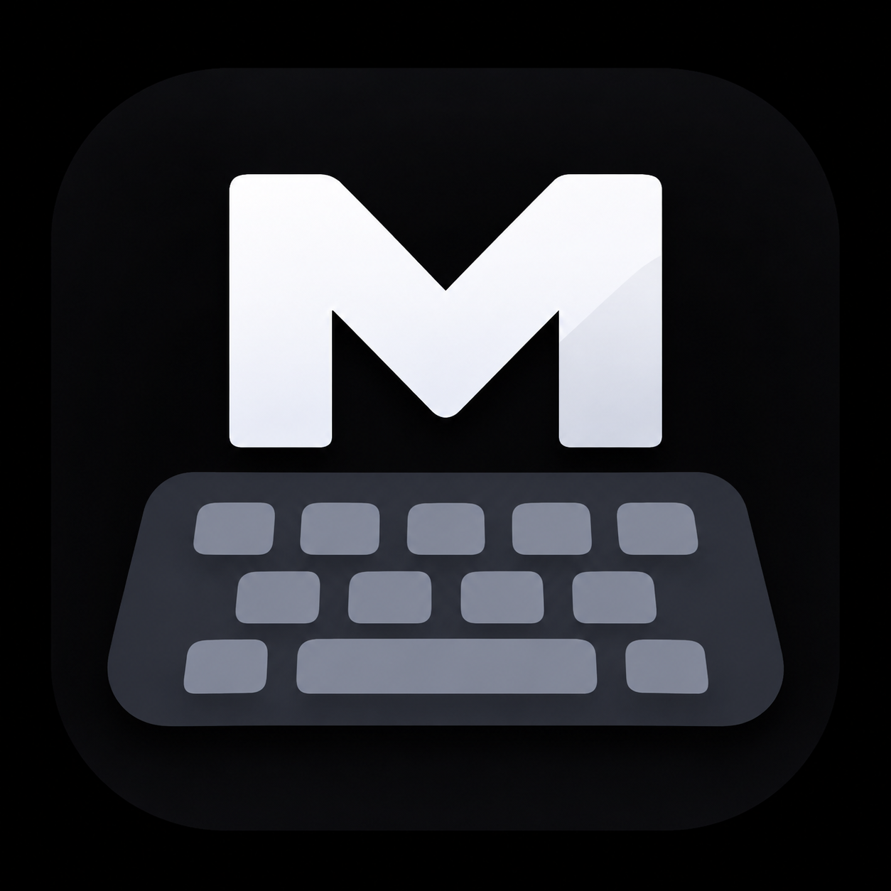
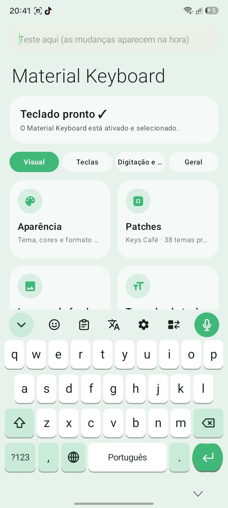
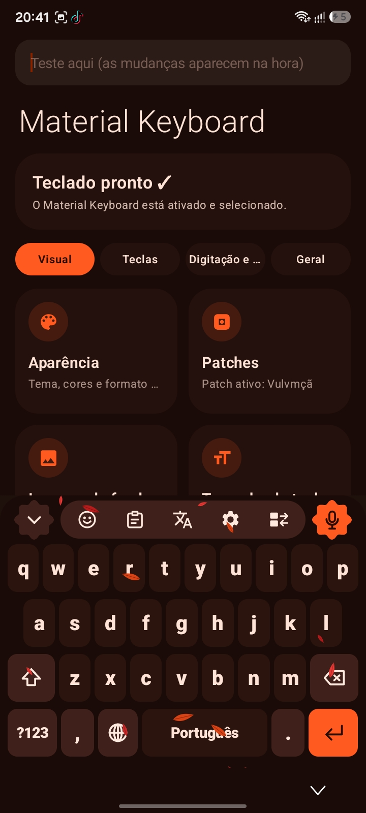
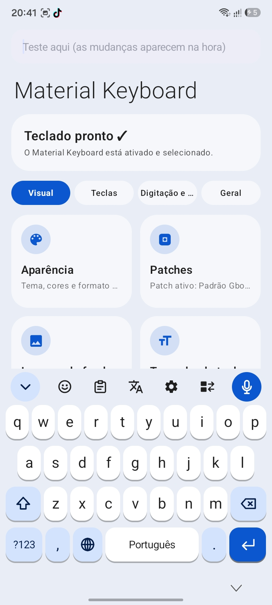

  

<h1 align="center">Material Keyboard</h1>

  Your keyboard, your style.

  A modern Android keyboard focused on customization, personalization and a smooth typing experience.

---

## About

Material Keyboard is an Android keyboard project designed to offer a modern visual experience and more ways to personalize your typing environment.

Our goal is to make everyday typing more comfortable, customizable and visually appealing.

## Themes

### Green Theme

  

### Brown Theme

  

### Blue Theme

  

## Features

- Modern keyboard interface
- Visual personalization
- Customizable themes
- Continuous improvements and updates

## Download

Visit the official GitHub repository to find the latest available releases.

[Download Material Keyboard](https://github.com/ewertonvitor468-bot/materialkeyboard/releases)

## Developer

Created by Ewerton Vitor.

---

  Material Keyboard — Your keyboard, your style.

